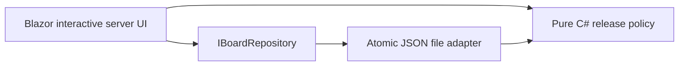
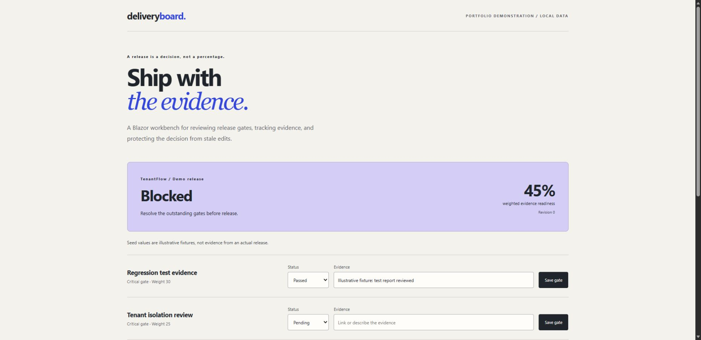

# DeliveryBoard — C# / Blazor release-readiness workbench

A **new portfolio demonstration** by Armando Francisco Denardi. This is not employer software or evidence of a historical production deployment. Blazor here is an interactive server-rendered **web** application, not a mobile app.

## Why this exists

Weighted completion percentages often hide unresolved release risks. DeliveryBoard keeps the score explanatory: a failed gate or pending critical gate blocks release even at 99% readiness. Passing requires evidence. Concurrent saves carry an expected revision so a stale browser cannot silently replace a newer edit.

## Run

Requires .NET 10 SDK. No database, account, or cloud subscription is needed.

```sh
dotnet restore DeliveryBoard.sln
dotnet test DeliveryBoard.sln
dotnet run --project src/DeliveryBoard.Web --no-launch-profile -- --urls http://127.0.0.1:5087
```

Open http://127.0.0.1:5087. Set a gate to **Passed**, add evidence, and save it. Open two browser tabs to observe stale-revision handling. The initial data is explicitly illustrative. `/api/board` exports the current board as JSON; `/health` is a smoke-check endpoint. Saved data lives in ignored `src/DeliveryBoard.Web/App_Data/board.json`; set `BoardPath` to use a separate file.

## Architecture



- `DeliveryBoard.Core`: immutable gate/value records, validation, weighted readiness, hard-gate rules, repository contract.
- `DeliveryBoard.Web`: Razor UI and a single-process file adapter. Saves are serialized, revisions checked under the same lock, and JSON replaced using a same-directory temporary file.
- `DeliveryBoard.Tests`: domain and persistence/concurrency tests, including stale-write races, rejected edits preserving bytes, persistence across instances, and corrupt data failing rather than silently resetting.

## Deliberate boundaries

This is a local, single-user demonstration without authentication or an audit ledger. Do not expose it as a production administrative service. The file lock is process-local; multi-instance hosting needs a shared transactional database or a compare-and-swap storage adapter. A cloud version should add Entra ID authorization, an audit trail, durable shared storage, and an explicit retention policy. No Azure resources are provisioned by this repository.

GitHub Pages cannot host this server-rendered Blazor application; the portfolio links to this runnable source. The Azure implementation example lives separately in [TenantFlow](https://github.com/kawmy/tenantflow-dotnet).

## Validation

Run the commands above for fresh evidence. The checked-in CI builds and tests on .NET 10, and fails on compiler/analyzer warnings. Validation results from the initial portfolio build are recorded separately in `VALIDATION.md`; no CI success badge is claimed before an actual run.

## Framework reference

[Microsoft: Blazor render modes](https://learn.microsoft.com/en-us/aspnet/core/blazor/components/render-modes?view=aspnetcore-10.0).

## Running interface



